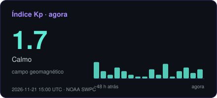
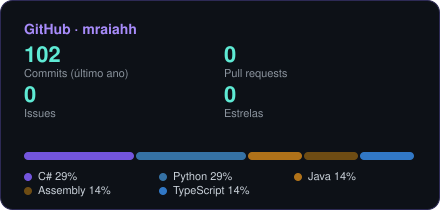

 

 

*"For the first time I'm thinking past tomorrow."* ✨

## Get to know me!

Trabalho com desenvolvimento, carrego nas minhas experiências um período de dois anos de iniciação científica em física espacial e amo como a tecnologia está em todas as áreas. Além de clicar e digitar, gosto de arte, crochê, musicais e astronomia.

 

<table align="center">
  <tr>
    <td width="33%" valign="top">
      <h3>💻 Trabalho</h3>
      Dev estagiária 
      <b>Protheus / TOTVS</b> 
      ADVPL · Git · trabalho em equipe
    </td>
    <td width="33%" valign="top">
      <h3>🛰️ Pesquisa</h3>
      IC concluída com bolsa <b>FAPESP</b> 
      <b>Ionosfera em períodos perturbados</b> 
      IP&amp;D / UNIVAP · Física Espacial
    </td>
    <td width="33%" valign="top">
      <h3>🎓 Graduação</h3>
      <b>Engenharia da Computação</b> 
      UNIVAP 
      2022 - 2026
    </td>
  </tr>
</table>

## 🧰 Stack

<table>
  <tr>
    <td><b>Linguagens</b></td>
    <td>
      
      
      
      
      
      
      
    </td>
  </tr>
  <tr>
    <td><b>ERP</b></td>
    <td>
      
    </td>
  </tr>
  <tr>
    <td><b>IoT &amp; embarcados</b></td>
    <td>
      
      
      
      
    </td>
  </tr>
  <tr>
    <td><b>Ferramentas</b></td>
    <td>
      
      
      
      
      
    </td>
  </tr>
</table>

## ☀️ Clima espacial agora

  
  &nbsp;&nbsp;&nbsp;
  
   
  Dados: NOAA SWPC · NASA SDO

## 📈 No GitHub

  

## 📫 Contato

